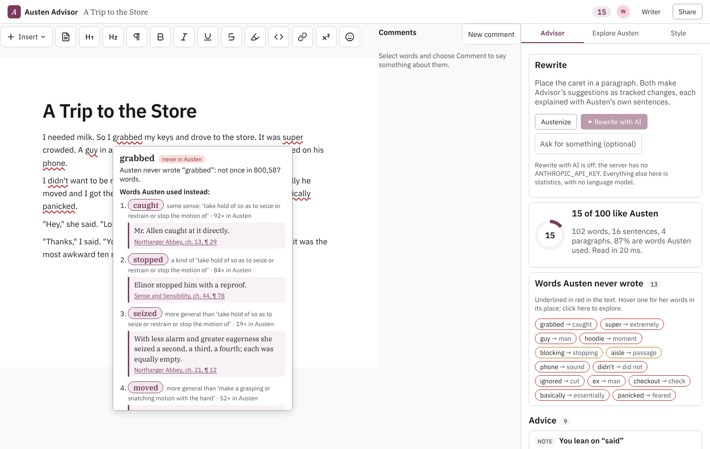
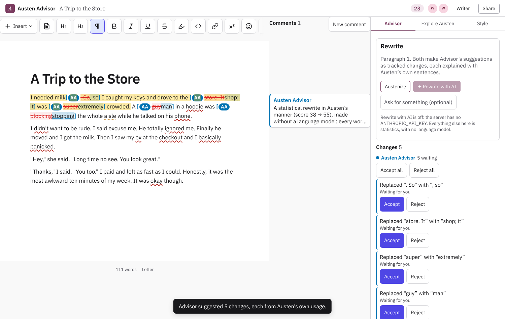

# Austen Advisor

A shared word processor where you write and **Advisor** writes beside you. Advisor is a statistical model of the complete works of Jane Austen. It is there to teach you to write, and to think like an author, not to write for you.

- **Every word Austen never wrote is underlined as you type.** Hover one to see the words she did use in its place, ranked by meaning and fit. Each comes with a real sentence of hers and where to find it (work, chapter, paragraph). Click one to put it in.
- **Advice with the numbers behind it.** Advisor flags contractions where she wrote the words out, and runs of short sentences she would have joined (with the join she would most likely use). It also flags a word she would more likely have written in that spot, and habits of yours that are not hers ("you use *really* 9 times in a thousand words; Austen, 0.7"). Every piece of advice cites her sentences.
- **Explore her language as you write.** Select any word or phrase. You see how often she used it and in which novels, the words nearest it in her own usage, the words found beside it, and her sentences containing it. Each sentence opens into its paragraph.
- **Figures of speech recognized and named.** Litotes, periphrasis, antithesis, tricolon, polysyndeton, inversion, the ironic generalization and aside, free indirect discourse and more are found by their form. They are underlined in your draft, named in every rewrite's reasons, and labelled on every Austen sentence shown. Hover one, or search one in Explore ("tricolon" gives "Emma Woodhouse, handsome, clever, and rich").
- **The Style panel** measures your writing against hers: sentence and paragraph length, semicolons, commas, -ly adverbs, contractions, function-word habits (Burrows's Delta) and readability. Each measure is a habit you can practise.
- **Advisor's suggestions are tracked changes.** You accept or reject them as you would a colleague's in Google Docs, and a thread in the margin explains each one. *Austenize* rewrites a paragraph by statistics alone. *Rewrite with AI* gives the passage to Claude together with the engine: Claude looks up words, checks idioms in the concordance, checks its own draft, and cites the sentences it learned from. Each quotation is verified against the corpus before you see it.
- **Shared, like a Google Doc.** Anyone with the link writes with you, live. Ask Advisor anything in a comment thread.





The editor, margin, redline and review panel are [Tiny Little Office](https://github.com/aboard-io/tinylittleoffice)'s, from its `v2` branch. Its kernel orders everyone's edits on the server.

See **[docs/rewrite-eval.md](docs/rewrite-eval.md)** for how the AI rewrite was designed and tested: three rounds of Claude Sonnet rewriting and Claude Opus judging, and what each round changed. See **[docs/before-after.md](docs/before-after.md)** for six everyday pieces (a trip to the store, a letter home from camp, a breakup…), each before and after the engine. Every change is listed with its reason and a sentence of Austen's.

## Running it

Node 24 or later.

```sh
npm install
npm run build:model -- austen   # ~3 minutes, once: fetches the works, WordNet and the Brown Corpus, trains the model
npm run dev                     # http://localhost:4180
```

`npm run build:model` writes three files to `data/`:

- `data/english.sqlite`: WordNet 3.1, and a part-of-speech tagger trained on the Brown Corpus. Both are shared by every author.
- `data/austen.sqlite`: the corpus, its full-text index, and the model.
- `data/documents.sqlite`: the documents. The server writes this one as people use it.

Rewrite with AI needs an API key where the server runs:

```sh
ANTHROPIC_API_KEY=… npm run dev
```

Everything else needs no language model and no network once the model is built.

```sh
npm test                                   # the engine, the corpus readers, the sync
npm run cli -- analyze samples/store.txt   # what Advisor flags and advises
npm run cli -- austenize samples/store.txt # the statistical rewrite, with reasons and sources
npm run cli -- word tolerable              # how she used a word
npm run cli -- concordance "at last"       # her sentences with a phrase
npm run cli -- similar "I went to the shop to buy bread"
npm run cli -- rewrite samples/store.txt   # Claude + the engine (needs the key)
npm run before-after [-- --ai]             # regenerate docs/before-after.md
npm run build && npm start                 # the built page, served by the same server
```

## The corpus

All of Austen's published novels come from [Standard Ebooks](https://github.com/standardebooks) on GitHub: *Sense and Sensibility*, *Pride and Prejudice*, *Mansfield Park*, *Emma*, *Northanger Abbey* and *Persuasion*. These are clean XHTML with chapters, paragraphs, letters and verse marked up. The minor works come from Project Gutenberg's texts by way of GITenberg, with the boilerplate removed:

- *Lady Susan*
- the juvenilia, *Love and Freindship*
- *Sanditon*, from the 1925 transcription of the manuscript, with its editorial notes dropped

That makes 800,587 words in 357 chapters, 10,887 paragraphs and 34,296 sentences. Every sentence is kept with its citation. `authors/austen.json` lists the works and where each comes from.

## How it works

See [docs/engine.md](docs/engine.md). In short, the engine is built from a century of language technology, with no language model:

- **Vocabulary and inflection:** every form she used, by part of speech, by work, and in narration or speech.
- **Part-of-speech tagging:** an averaged perceptron (Rosenblatt 1958; Collins 2002) trained on the Brown Corpus. It scores 97.2% on held-out text.
- **Language model:** a trigram model of her sentences with interpolated Kneser–Ney smoothing (Shannon 1948; Kneser & Ney 1995; Chen & Goodman 1998).
- **Word senses:** WordNet 3.1 (Miller, 1985–) for senses, synonyms and related words, with Morphy for lemmas. Simplified Lesk (1986) picks the sense meant in context.
- **Word vectors:** positive PMI with a smoothed context distribution (Church & Hanks 1990; Levy, Goldberg & Dagan 2015), factored by randomized SVD (Halko, Martinsson & Tropp 2011). They are trained on her works alone, so "angry" sits next to *vexed*, *disappointed* and *astonished*.
- **Sentence similarity:** SIF sentence vectors (Arora, Liang & Ma 2017) find her sentences nearest yours in meaning.
- **Retrieval and collocation:** SQLite FTS5 ranked by BM25 (Robertson et al. 1994) for concordance, and Dunning's log-likelihood (1993) for collocates.
- **Spelling:** edit distance (Damerau 1964; Norvig 2007) catches typos.
- **Style:** Burrows's Delta (2002) over her 150 commonest words, plus Flesch–Kincaid (1975) readability.

## Another author

The engine knows nothing particular to Austen. An author is a JSON file of works and sources, and `authors/twain.json` is already there:

```sh
npm run build:model -- twain
```

This builds Twain Advisor from Standard Ebooks' Twain. The page lists every advisor, and a new document chooses one.

## Layout

```
authors/          an author: works and sources
src/corpus/       Standard Ebooks and Gutenberg into chapters, paragraphs, sentences (SQLite + FTS5)
src/nlp/          tokenizer, tagger, WordNet, Kneser–Ney, SVD, ZIP
src/train/        the build: english.sqlite and <author>.sqlite
src/engine/       the model in memory; analysis, alternatives, austenize, tools (one set for the page, the API and Claude)
src/server/       HTTP + WebSocket: documents, sync (Tiny Little Office's kernel), Advisor, the AI rewrite
src/web/          the page: Tiny Little Office's Word Processor, margin and review panel, Advisor's panels
vendor/           Tiny Little Office's library, built from its v2 branch (npm run vendor:tlo to refresh)
```
